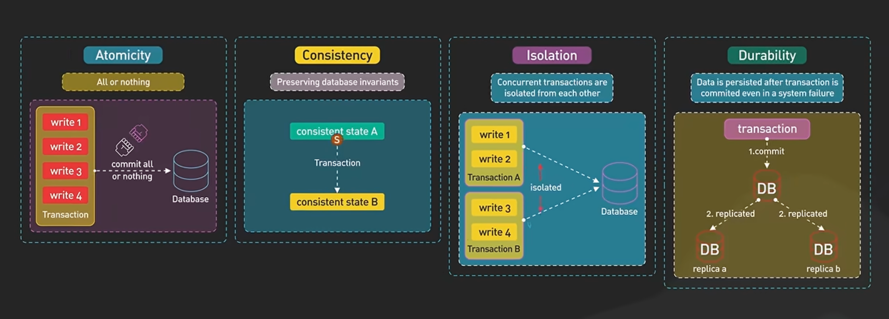
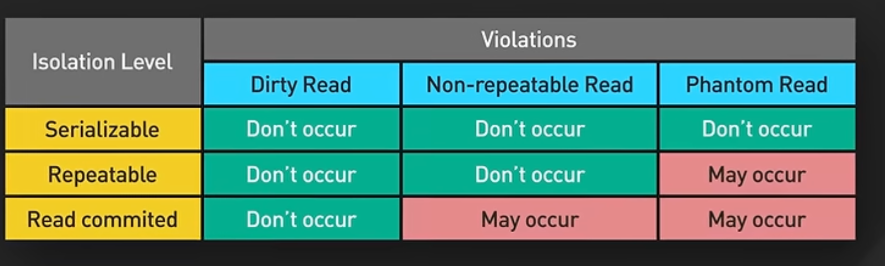

## ACID Properties
ACID properties guarantee database reliability across concurrent access and failures.



### Atomicity
"All or nothing." Every operation within a transaction either succeeds completely and is committed, or fails and is rolled back so no partial changes remain.

### Consistency
Guarantees every committed transaction transitions the database from one valid state to another, respecting all schema rules (PRIMARY KEY, FOREIGN KEY, UNIQUE, CHECK, NOT NULL), triggers, and domain invariants.

``` info
Example: A CHECK (balance >= 0) constraint prevents a withdrawal from overdrawing an account, causing the transaction to fail and roll back.
```

### Isolation
Controls how concurrent transactions see each other's uncommitted or in-flight changes so they behave safely and predictably:
- **Read Uncommitted**: In PostgreSQL, behaves like Read Committed (dirty reads are not allowed).
- ***Read Committed (PostgreSQL Default)***: Each SQL statement sees only data committed before that statement starts. Prevents dirty reads, but non-repeatable reads and phantom reads can occur.
- ***Repeatable Read***: Uses a transaction-level snapshot so repeated reads of the same rows return consistent values (prevents non-repeatable reads). 
    > [!TIP]
    > Notably, PostgreSQL's snapshot isolation also prevents phantom reads. 

- ***Serializable***: Ensures concurrent transactions produce a result equivalent to running them in some serial order. Rather than simply blocking all later transactions with row locks, PostgreSQL uses Serializable Snapshot Isolation (SSI) to detect conflicting read/write cycles and aborts conflicting transactions (SQLSTATE 40001) so the client can retry.



### Durability
Once a transaction is committed, its changes persist permanently—even after crashes, restarts, or power loss. PostgreSQL achieves this primarily through Write-Ahead Logging (WAL), flushing log records to durable storage before confirming commit.

### Reference
[ACID Properties in Databases With Examples](https://www.youtube.com/watch?v=GAe5oB742dw)