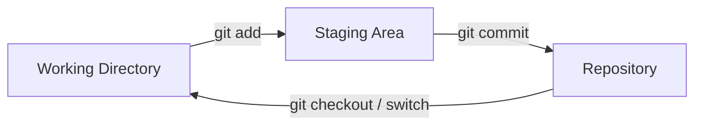
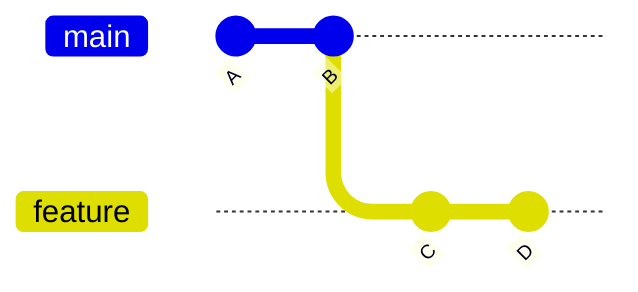
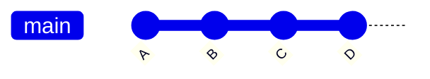
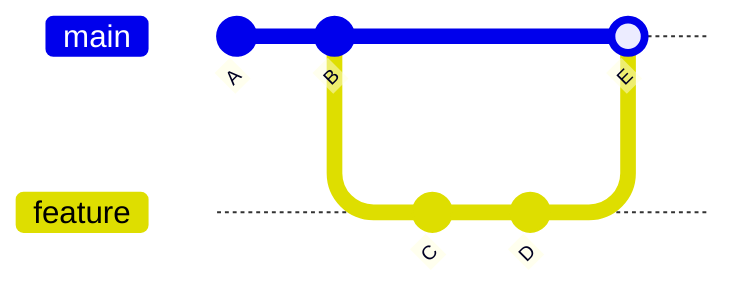
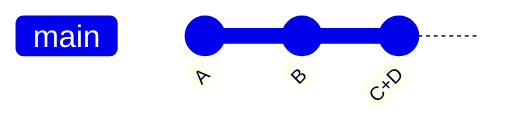
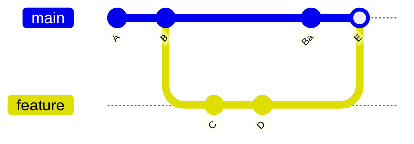
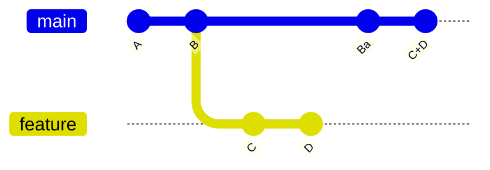
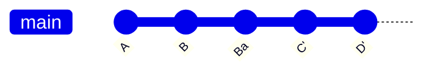

# Git Cheat Sheet & Quick Revision

A concise reference guide for essential Git operations, workflows, and branching strategies.

| Section | Topics |
| :--- | :--- |
| [Setup & Configuration](#1-setup-configuration) | Installation and global identity |
| [Core Workflow & Lifecycle](#2-core-workflow-lifecycle) | Basic commands |
| [History & Inspection](#3-history-inspection) | [Viewing history](#viewing-history), [inspecting differences](#inspecting-differences-git-diff) |
| [Time Travel & Checkout](#4-time-travel-checkout) | Switching commits and restoring files |
| [Branching & Merging](#5-branching-merging) | [Branch operations](#branch-operations), [merge types and topologies](#merge-types-topologies) |
| [Sync With Origin](#sync-with-origin) | [Name the local branch](#1-ensure-your-local-branch-is-named-main), [map the remote](#2-map-your-local-repository-to-your-remote-repository-url), [push commits](#3-push-your-local-commits-and-set-the-remote-tracking-branch) |

---

## 1. Setup & Configuration

Verify installation and configure global identity settings.

```bash
# Check installed Git version
git --version

# Access Git help documentation
git --help

# Set global user identity
git config --global user.name "Your Name"
git config --global user.email "you@example.com"

# List all current global configurations
git config --global --list
```

---

## 2. Core Workflow & Lifecycle



### Basic Commands

| Command | Action |
| :--- | :--- |
| `git init` | Initialize a new local Git repository |
| `git status` | Check working directory & staging area state |
| `git add <path>` | Stage specific file/folder (e.g., `git add src/*`) |
| `git commit -m "msg"` | Save staged changes with a descriptive message |

```bash
# Example Workflow:
git init
git status
git add src/*
git add *      # do not add sytem files or hidden file by default like .gitignore in
git add .gitignore # for system file you need to specificy there name explicitly
git commit -m "Initial commit"
```

---

## 3. History & Inspection

Track history and inspect code changes across stages.

### Viewing History

```bash
git log                  # Detailed commit history
git log --oneline        # Compact single-line summary per commit
git log --graph          # Visual branch topology
git log --all --graph --oneline  # Full repository history graph
```

### Inspecting Differences (`git diff`)

```bash
git diff                 # Working directory vs. Staging area
git diff --staged        # Staging area vs. Last commit (HEAD)
git diff HEAD~1          # Current commit vs. Previous commit
git diff src/index.html  # Working directory changes for specific file
git diff --staged src/index.html # Staged changes for specific file
```

---

## 4. Time Travel & Checkout

Switch contexts or restore working directory files to earlier commits.

```bash
# Move to a specific commit
git checkout <commit-id>

# Return to the latest commit on the main branch
git checkout main
```

---

## 5. Branching & Merging

Isolate feature development and combine changes back into target branches.

```bash
# Branch Operations
git branch my-new-feature     # Create a new branch
git checkout my-new-feature   # Switch to the new branch
```

### Merge Types & Topologies

#### 0. Orignal Scenario Before Merge



#### A. Fast-Forward Merge (Default Merge)
Occurs when target branch has no new commits since branching.



#### B. Non-Fast-Forward Merge (`--no-ff`)
Explicitly creates a merge commit to preserve history context.



```bash
# Combine branch history with an explicit merge commit
git merge --no-ff fix-incomplete-high-score -m "Fix high score tracker"
```

#### C. Squash Merge
Combines all feature branch commits into a single commit on the target branch.



```bash
# Squash merge feature branch into current branch
git merge --squash <feature-branch>
```


Because `main` has a new commit (`Ba`) that `feature` does not have, the branches have **diverged**.

When branches diverge like this, different merge strategies handle the history differently:

### 1. Fast-Forward Merge (`git merge feature` — Default)

* **Result:** **Impossible / Fails** (or automatically falls back to a 3-way merge commit if `--ff-only` isn't specified).
* **Why:** A true fast-forward merge requires the target branch (`main`) to have no new commits since `feature` branched off. Because commit `Ba` exists on `main`, Git cannot simply move the `main` pointer forward to `D`.
* **If forced with `--ff-only`:** Git aborts and outputs `fatal: Not possible to fast-forward, aborting.`

---

### 2. Three-Way Merge / Merge Commit (`git merge feature` or `git merge --no-ff feature`)

* **Result:** Creates a new **merge commit (`E`)** on `main` that ties together both histories (`Ba` and `D`), while keeping commits `C` and `D` intact on the `feature` branch.


* **When conflicts occur:** If `Ba` and `C`/`D` modified the same lines, you resolve them once, and the resolution is saved inside commit `E`.




---

### 3. Squash Merge (`git merge --squash feature`)

* **Result:** Combines the changes from `C` and `D` into a **single new commit (`C+D`)** placed directly on top of `Ba`.


* **History:** The individual commits `C` and `D` are not preserved in `main`'s history, and there is no merge connection line back to the `feature` branch.




---

### 4. Rebase and Merge (`git rebase main` on `feature`, then fast-forward `main`)

* **Result:** Replays commits `C` and `D` one by one on top of `Ba` (creating new commit hashes `C'` and `D'`), allowing `main` to then **fast-forward** cleanly.


* **History:** Produces a completely flat, linear history with no merge commits.


* **When conflicts occur:** You may have to resolve conflicts individually for `C'` and then again for `D'` as each commit is reapplied.




#### Explained in Detail:

To execute a **Rebase and Merge** cleanly (moving commits `C` and `D` onto `Ba` and fast-forwarding `main`), follow these sequential commands:

##### 1. Rebase `feature` onto `main`

Switch to your `feature` branch and replay its commits (`C` and `D`) on top of the latest `main` commit (`Ba`).

```bash
# Switch to the feature branch
git checkout feature

# Replay commits C and D onto main (commit Ba)
git rebase main

```

* **Verification:** Run `git log --oneline` to confirm `C` and `D` now appear directly above `Ba` with newly generated commit hashes (`C'` and `D'`).


##### 2. Handling Conflicts During Rebase (If They Occur)

If `Ba` conflicts with `C` or `D`, Git pauses the rebase at the conflicting commit.

```bash
# 1. Open the conflicted file(s), fix the code, and remove conflict markers (<<<<<<<, =======, >>>>>>>)

# 2. Stage the resolved file(s)
git add <resolved-file>

# 3. Continue replaying the remaining commits
git rebase --continue

```

*(Note: If you ever want to cancel and go back to how things were before rebasing, run `git rebase --abort`.)*

* **Verification:** Repeat until Git outputs `Successfully rebased and updated refs/heads/feature.`


##### 3. Fast-Forward `main` to Match `feature`

Once `feature` sits linearly on top of `Ba`, switch back to `main` and merge. Because there is no divergence anymore, Git automatically performs a clean **fast-forward merge**.

```bash
# Switch back to main
git checkout main

# Fast-forward main to D' (creating a flat, linear history)
git merge feature

```

* **Verification:** Run `git log --all --graph --oneline` to confirm a single straight line (`A → B → Ba → C' → D'`) with no merge commits.


##### 4. Clean Up & Push (Optional)

If you previously pushed `feature` to a remote repository (like GitHub), rewriting its commit hashes (`C'` and `D'`) requires a safe force-push, or you can simply delete the branch if you are done with it.

```bash
# Delete the local feature branch pointer now that it's merged
git branch -d feature

# Push the updated linear main branch to remote
git push origin main

```

* **Verification:** Run `git status` to verify your working tree is clean and `main` is up to date with `origin/main`.

---

### Quick Summary

| Strategy | Works on Diverged Branches? | Resulting `main` History | Preserves `C` & `D`? |
| --- | --- | --- | --- |
| **Fast-Forward (`--ff-only`)** | ❌ No (Aborts) | N/A | N/A |
| **Merge Commit (`--no-ff`)** | ✅ Yes | `A → B → Ba → E` (with branch loop)      | Yes, exact hashes |
| **Squash Merge (`--squash`)** | ✅ Yes | `A → B → Ba → (C+D)` | No (combined into one) |
| **Rebase + Merge** | ✅ Yes | `A → B → Ba → C' → D'` | Yes, rewritten as `C'`,`D'`|

## Sync With Origin

### Pushing a Local Repository to a Remote

Follow these steps to map your local repository to a remote repository and ensure your `main` branch matches without issues.

### 1. Ensure your local branch is named `main`

```bash
git branch -M main

```

* **Verification:** Run `git branch` to confirm that an asterisk `*` appears next to `main`.

---

### 2. Map your local repository to your remote repository URL

```bash
git remote add origin https://github.com/YourUsername/Your-Repo-Name.git

```

* **Verification:** Run `git remote -v` to ensure the correct fetch and push URLs are listed.

---

### 3. Push your local commits and set the remote tracking branch

```bash
git push -u origin main. #Once you use -u the first time,  
                     #you don't need to specify the remote and branch name for future pushes and pulls.
```

* **Verification:** Run `git status` to confirm your branch is up to date with `origin/main` and no errors are returned.

## YouTube Reference
[How Git Works](https://youtu.be/e9lnsKot_SQ?si=W4vzxz7yHHJ5J_97)
[Git Merge Vs Rebase](https://youtu.be/0chZFIZLR_0?si=BY6fNy5sRQYi91R5)